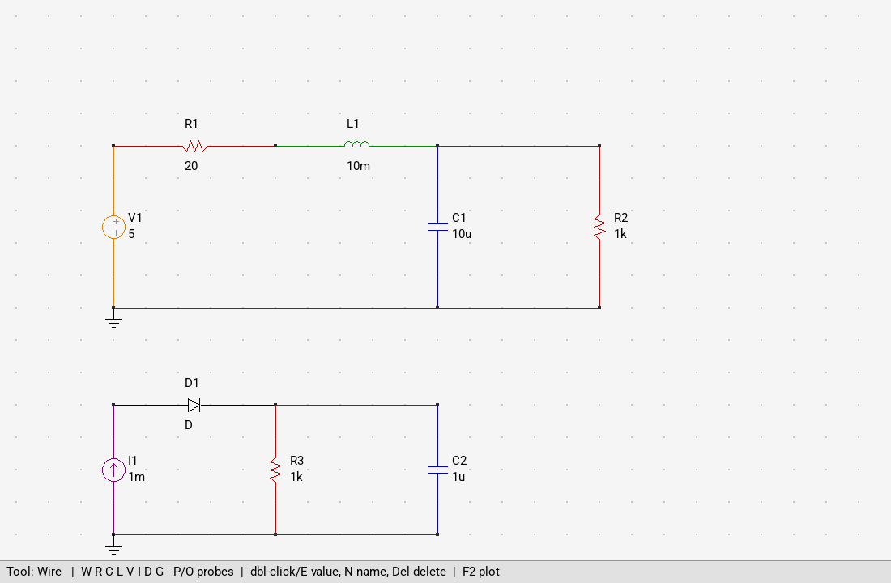
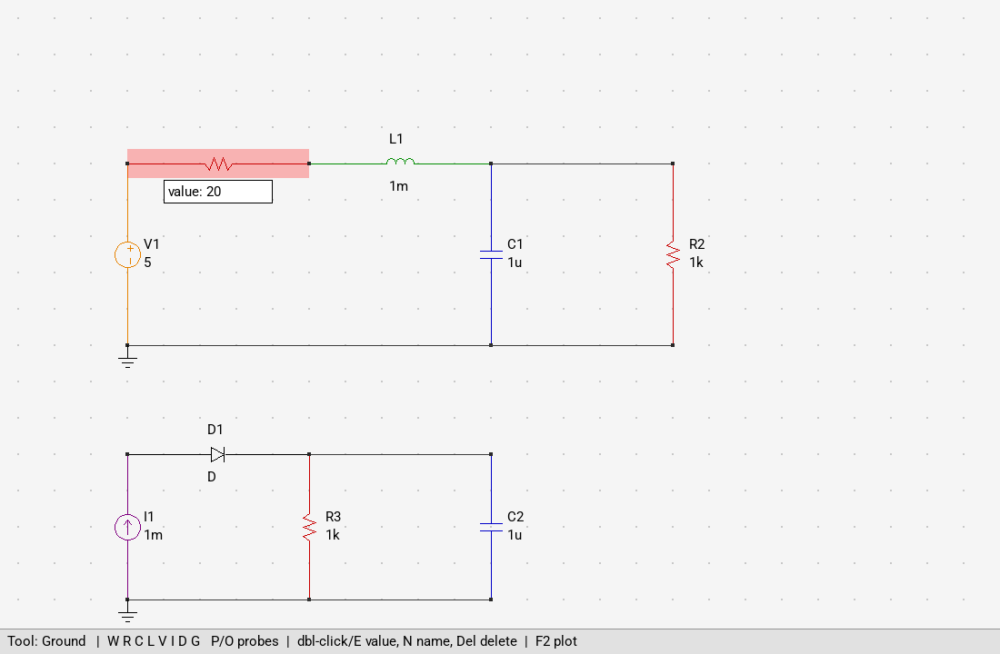
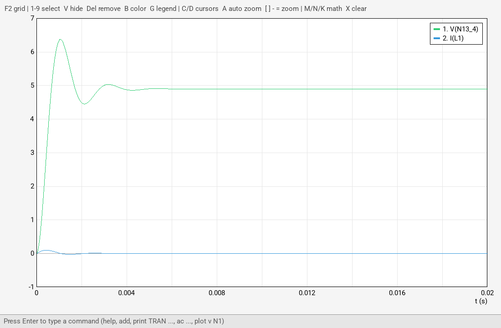
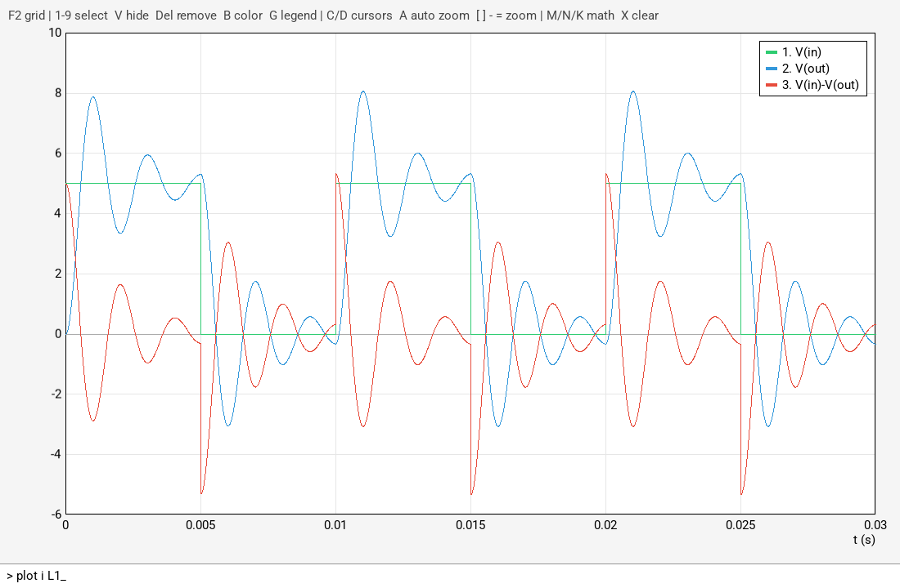
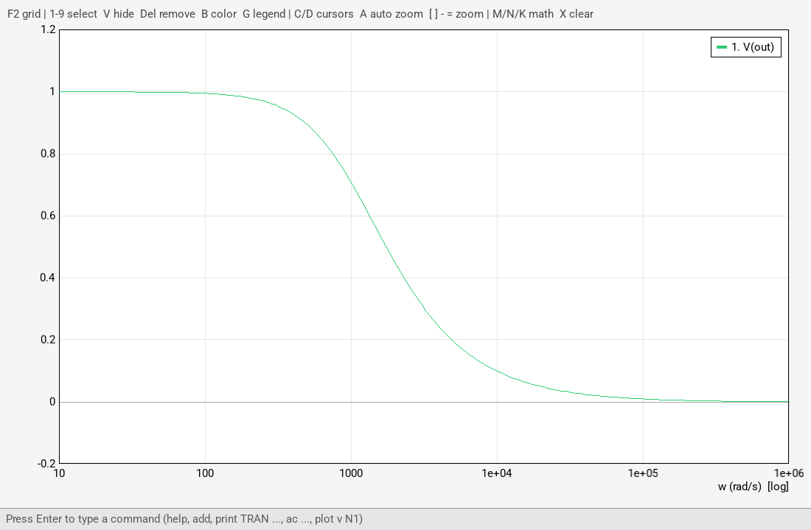
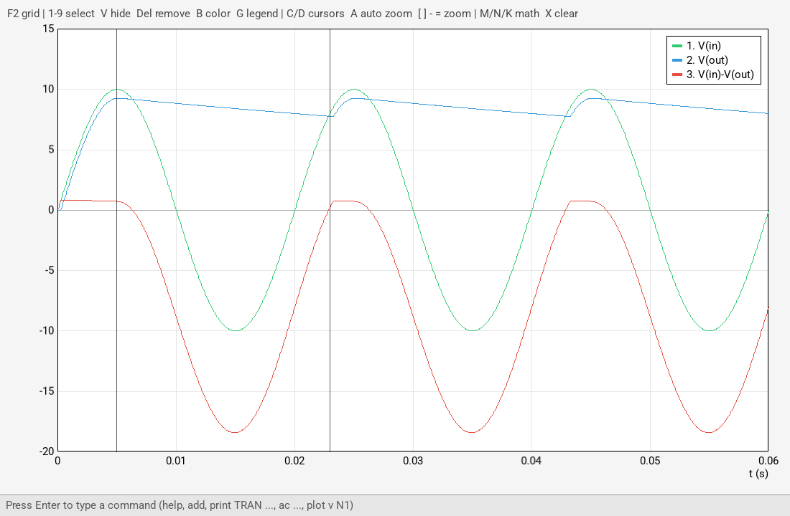

<p align="center">
  
</p>

<h1 align="center">MorghSpicy</h1>

<p align="center">
  A small circuit simulator written in C++, inspired by LTspice.<br>
  Term project for the Object Oriented Programming course, Electrical Engineering, Sharif University of Technology (spring 2025).
</p>

---

MorghSpicy is the circuit simulator my teammates and I built for our OOP course. The goal was to write
something like a mini LTspice from scratch: you describe a circuit (either by drawing it or by typing a
netlist), the program builds the circuit equations, solves them, and shows you the waveforms.

The project had two phases. In phase 1 it was a console program that read commands and printed
tables. In phase 2 we added a graphical interface with SDL3: a schematic editor on a grid and a plot
window. Both still work, so you can use whichever one you like.

<p align="center">
  
</p>

## What it can do

### Circuit elements

I implemented these elements, and each of them adds its own part to the circuit equations (details below):

- resistor, capacitor, inductor
- DC voltage and current sources
- pulse source `PULSE(v1 v2 delay rise fall width period)` and sine source `SIN(offset amplitude freq phase)`
- diode and zener diode (these are nonlinear, so they are solved with Newton-Raphson)
- all four dependent sources: VCVS (`E`), VCCS (`G`), CCVS (`H`) and CCCS (`F`)
- subcircuits: you can save part of a circuit as a two terminal block and use it again as many times as you want

### Analyses

- **Transient:** voltages and currents over time (backward Euler, fixed time step)
- **DC sweep:** sweeps a voltage or current source over a range and records the outputs
- **AC sweep:** frequency response with linear, decade or octave spacing. The sine sources are the inputs
- **Phase sweep:** changes the phase of one sine source at a fixed frequency

### Drawing circuits

The first page is the schematic editor. You choose a part with a key (`R`, `C`, `L`, `V`, `I`, `D`, `W`
for wire, `G` for ground) and click twice on the grid to place it. It snaps to horizontal or vertical,
so vertical parts are drawn rotated. Clicking a part selects it. From there you can delete it, rename
it, or double click it to change its value.

<p align="center">
  
</p>

After the circuit is drawn, the voltage probe (`P`) and the current probe (`O`) run a transient
simulation and plot the result directly: click a node for its voltage, or click a part for the current
through it. The picture below is what the probes show for the RLC circuit above (the node voltage
rings and settles at the value set by the resistor divider).

<p align="center">
  
</p>

### Plot window and command bar

`F2` switches to the plot page. The plot has a legend, zoom and pan, and one or two cursors that print
the values, `dx`, `dy` and the slope between them. Series can be hidden, removed, recolored or renamed,
and you can add or subtract the last two signals. AC results are drawn on a log frequency axis.

All the text commands from phase 1 also work in the command bar at the bottom of this page (press
`Enter`, type, press `Enter` again). So you can load a netlist and plot it without drawing anything:

<p align="center">
  
</p>

Here are two more examples, the frequency response of an RC low pass filter, and a half wave rectifier
where I placed two cursors to measure the difference between two points:

<p align="center">
  
  
</p>

### Console mode

If you run `MorghSpicy --cli` you get the phase 1 console with the same commands, and results are
printed as tables:

```text
>>> load rc_step.txt
Loading circuit from file: schematics\rc_step.txt
Added element: V1
Added element: R1
Added element: C1
Finished loading from file.
>>> print TRAN 2m 10m V(N2) I(C1)
t (s)           V(N2)           I(C1)
0.002           0.833333        0.00416667
0.004           1.52778         0.00347222
0.006           2.10648         0.00289352
0.008           2.58873         0.00241127
0.01            2.99061         0.00200939
```

## How it works

This part was the most interesting for me, so here is a short summary of what happens inside:

- **Modified Nodal Analysis (MNA).** Every element class has a `stampMNA` function that adds its
  contribution to the matrix equation `A x = b`. Unknowns are the node voltages, plus one current for
  each voltage source, inductor, `E` and `H`. Because of these extra currents, the current controlled
  sources (`F`, `H`) can read their control current directly from the solution vector.
- **Transient.** Capacitors and inductors are replaced by their backward Euler companion models at every
  time step. If the circuit has a diode, each step repeats Newton-Raphson (linearize the diode around
  the last guess and solve again) until the answer stops changing.
- **DC.** It uses the same stamps with a very large time step, so capacitors become open circuits and
  inductors become short circuits.
- **AC.** It builds a separate complex matrix at each frequency. DC sources are set to zero and sine
  sources become phasors.
- **Nodes.** Node names can be numbers or labels (`vdd`, or `N3_4` for grid points). Wires and ground
  are handled with a union-find structure in `NodeManager`: shorting two nodes merges their sets, and
  before solving every element is moved to the root node of its set.
- The matrices are solved with [Eigen](https://eigen.tuxfamily.org/).

The code is organized roughly like MVC:

```text
main.cpp                  starts the GUI, or the console with --cli
Model/
  Elements.h/.cpp         element classes and their MNA stamps
  Graph.h/.cpp            list of elements, connectivity check
  NodeManager.h/.cpp      node names + union-find for shorted nodes
  MNASolver.h/.cpp        builds and solves A x = b
Controller/
  CommandParser.h/.cpp    text commands, save / load, subcircuits
  SimulationRunner.h/.cpp transient, DC, AC and phase analyses
  Signal.h/.cpp           reads sampled signals from text files
  Exceptions.h            error types used by the parser
View/
  App.h/.cpp              window, pages and command bar
  CircuitGrid.h/.cpp      schematic editor
  Plotter.h/.cpp          plot window
assets/                   logo, icon, font and a demo signal
schematics/               example circuits
```

## Building

You need a C++20 compiler, CMake 3.24 or newer, **SDL3**, **SDL3_ttf** and **Eigen3**.

### Windows (MSYS2)

This is the setup I used. In an MSYS2 UCRT64 terminal, install the packages:

```bash
pacman -S mingw-w64-ucrt-x86_64-gcc mingw-w64-ucrt-x86_64-cmake mingw-w64-ucrt-x86_64-ninja mingw-w64-ucrt-x86_64-sdl3 mingw-w64-ucrt-x86_64-sdl3-ttf mingw-w64-ucrt-x86_64-eigen3
```

Then build and run:

```bash
cmake -S . -B build -G Ninja
```

```bash
cmake --build build
```

```bash
./build/MorghSpicy.exe
```

The build copies the font, the icon, the example circuits and the SDL dlls next to the exe. If Windows
still says a dll is missing, run it from the MSYS2 terminal or add `C:\msys64\ucrt64\bin` to `PATH`.

**CLion:** in *Settings > Build, Execution, Deployment > Toolchains* add a MinGW toolchain with
`C:\msys64\ucrt64` as its path and move it to the top, then use *Tools > CMake > Reset Cache and Reload
Project*. An old `C:\MinGW` install is 32 bit and can't build this project.

### Linux / macOS

Install SDL3, SDL3_ttf and Eigen3 with your package manager (`brew install sdl3 sdl3_ttf eigen` on
macOS; on Linux you may have to build SDL3 from source if your distro doesn't have it yet). Then use the
same cmake commands and run `./build/MorghSpicy`.

## How to use it

### Schematic editor

| Key / mouse | Action |
|---|---|
| `W` `R` `C` `L` `V` `I` `D` | wire, resistor, capacitor, inductor, voltage source, current source, diode |
| `G` | ground (one click) |
| click, click | place the part between two grid points |
| click on a part | select it |
| double click or `E` | change the value (for a diode: `D` or `Z`) |
| `N` | rename the selected part |
| `Del` / `Backspace` | delete the selected part |
| right click / `Esc` | cancel |
| `P` then click a node | plot its voltage |
| `O` then click a part | plot its current |
| `F2` | go to the plot page |

A few notes:
- the first click of a voltage source is its `+` terminal, and the arrow of a current source points
  from the first click to the second
- a pin that touches the middle of a wire is connected to it, but two wires that only cross are not
- the probes use the transient settings from the `tran` command (10 us step, 50 ms by default)

### Plot page

| Key | Action |
|---|---|
| `Enter` | open the command bar (`Up` / `Down` go through the history) |
| `1`-`9` | select a series |
| `V` / `Del` / `B` | hide, remove or recolor the selected series |
| `G` | show / hide the legend |
| mouse wheel, `[` `]` `-` `=` | zoom |
| drag (right button while the cursor is on) | pan |
| `A` | auto zoom |
| `C` / `D` | first cursor, second cursor (values are printed in the console) |
| `M` / `N` / `K` | sum or difference of the last two series, last series times 2 |
| `X` | clear the plot |
| `L` | load the demo signal `assets/signal_demo.txt` (`S` switches to reading only the first chunk) |

Some commands only exist on this page: `clear`, `relabel <index> <name>` and `grid`.

### Commands

The same commands work in the command bar and in the console. Numbers can use the usual SPICE
suffixes: `f p n u m k meg g t` (for example `1k`, `4.7u`, `2meg`).

```text
add R1 n1 n2 1k                    R, C, L, V, I
add D1 anode cathode D             D = normal diode, Z = zener (5.1 V)
add V1 in 0 PULSE(0 5 0 1u 1u 5m 10m)
add V2 in 0 SIN(0 10 50 0)         offset, amplitude, frequency (Hz), phase (deg)
add S1 in 0 0 10 50                the older way of writing a sine source
add E1 out 0 cp cn 10              VCVS (G1 ... for VCCS)
add H1 out 0 Vsense 100            CCVS controlled by the current of Vsense (F1 ... for CCCS)
add GND n1                         connect n1 to ground (0 and gnd also mean ground)
connect a b                        short two nodes
label 3 vout  |  rename node a b
delete R1  |  value R1 2k  |  list [R]  |  .nodes  |  reset

print TRAN <tstep> <tstop> [<tmaxstep>] V(n1) I(R1) ...
print DC <source> <start> <stop> <step> V(n1) ...
ac <lin|dec|oct> <w_start> <w_stop> <points> V(n1) ...      (w in rad/s)
phase <w> <phi_start> <phi_stop> <points> [source] V(n1) ...
tran <tstep> <tstop> [<tmaxstep>]                  settings for plot and the probes
plot v <node> [node2]  |  plot i <element>

save my_circuit.txt  |  load my_circuit.txt  |  show existing schematics  |  load 2
subcircuit create Divider from p q    and then    add X1 in out Divider
scope load path=assets/signal_demo.txt Fs=10k t=0.1  |  scope clear
help
```

`print` shows a table in the console, and when the GUI is open it also plots the result.

### Circuit files

Circuits are saved as plain text, one element per line with its type letter first. Lines starting
with `*` or `#` are comments, and any normal command can also go in the file:

```text
* RC charging, tau = 10ms
V V1 N1 0 5
R R1 N1 N2 1k
C C1 N2 0 10u
```

I put some example circuits in [`schematics/`](schematics) that are good for trying things out:

| File | Try this |
|---|---|
| `rc_step.txt` | `print TRAN 1m 50m V(N2) I(C1)` |
| `rlc_pulse.txt` | `print TRAN 10u 30m V(in) V(out)` |
| `half_wave_rectifier.txt` | `print TRAN 50u 60m V(in) V(out)` |
| `rc_lowpass_ac.txt` | `ac dec 10 1meg 200 V(out)` |
| `dependent_sources.txt` | `print DC V1 0 2 0.5 V(a) V(c) I(F1)` |

## Limitations

There are still things I would like to improve:

- the time step is fixed (no automatic step control), and every transient starts from zero, meaning
  empty capacitors and no inductor current
- in AC analysis the diode is treated as an open circuit because there is no small signal model yet
- AC and phase sweeps only show the magnitude, not the phase
- the grid editor and the netlist commands are separate, so a circuit loaded from a file is not
  drawn on the grid
- subcircuits can only contain R, L, C, V, I and diodes

## Team

- Mehrshad ([@mehrshot](https://github.com/mehrshot))
- Ali
- ER
